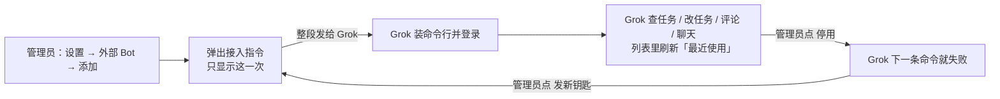

## 做成了什么

Settings now has an **外部 Bot** page. Only workspace owners and admins can see it.

- **添加:** you type a name, the type is Grok, and the key lasts forever by default (or pick 1 year). The page then shows one block of setup text. Copy all of it and send it to Grok. It covers installing the multica command line, logging in, switching to this workspace, the common commands, which domain goes to which agent, and the rule that outward actions are drafted and confirmed by you first.
- **List:** each Bot shows its type, last used time, date added and expiry date. A stopped Bot is marked 「已停用」 in red.
- **⋯ menu:**
  - 「停用」 takes effect at once: the Bot's next command fails (tested as 401).
  - 「发新钥匙」 kills the old key at once and gives a new setup text. A stopped Bot also comes back this way.
  - A stopped Bot can be deleted.
- **Members:** they don't see the entry and can't find it in settings search. A direct call to the API gets 403.
- **Agents:** agents can't issue Bot keys, by design. Only a person logged in can.
- **Command line:** `multica bot add / list / key / stop / delete` does the same thing.

**How to add and stop a Bot:** go to Settings → 外部 Bot → 添加 Bot. Type a name and click 生成钥匙. Click 复制 and paste the whole text to Grok. To stop it, click ⋯ on that row → 停用 → confirm. To bring it back, click ⋯ → 发新钥匙 and send the new text to Grok.

## 证据

- PR: https://github.com/jeff-kunkun/multica/pull/626
- Screenshots: `docs/evidence/DENE-1788/index.html` in the PR. They come from a real browser at 1280 and 390 and cover adding, the setup text, the list, the menu, the stop confirmation, the stopped state, and a member with no entry.
- **Browser run (real local environment):**
  - After the Bot made one call with its key, the list showed its last used time.
  - After stopping it, the same key got 401.
- **Server tests pass:**
  - members get 403;
  - the key works;
  - stop gives 401;
  - after a new key, the old one gets 401 and the new one works;
  - a running Bot can't be deleted;
  - Bots don't show up in the API Token list.
- **Checks:** migration lint, build, vet, typecheck, the new component tests and the locale parity check all pass.
- **One local failure, not from this change:** billing-tab has 3 date tests that fail on this machine's Node 26. This change doesn't touch that file.
- **Phone:** the 390px web page works throughout. The native app was not changed because it has no matching settings screen; the PR says so.

## 卡在哪

- **No new chats:** a Grok using the key can read and send in existing chats, but can't open a new chat by command. That command currently only works for agents mid-chat. If it's needed, it should be a separate follow-up ticket.
- **Real Grok not tried yet:** this step needs your Grok machine.

## 要你做的

1. Once it's merged and deployed to the live instance, add a Bot from the web page, send the setup text to your Grok, and see whether it can list tasks and post a comment. Then click 停用 and check that its next command fails.
2. Decide whether a Bot needs to open new chats by itself. If yes, I'll open a follow-up ticket.
