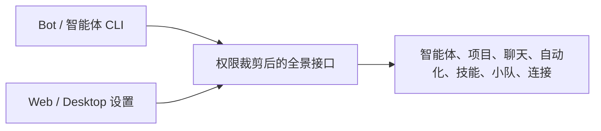

已完成实现并提交 [PR #630](https://github.com/jeff-kunkun/multica/pull/630)，交验收席复核权限与共享契约。尚未合并或部署。

现在一条 `multica overview` 就能读取工作区全景；Web/Desktop 设置也有同一入口，支持项目、智能体筛选。Bot 与主人的同权钥匙已通过真实鉴权对照，无权内容被裁掉，停用钥匙立即失效。内置 multica-platform Skill 已补开场使用指引。

验证：真实隔离数据库下接口及相关可见性测试通过；CLI help/JSON/单请求测试通过；前端类型检查、针对性 lint、4 个 API 测试及 39 个设置测试通过。手机 375/390、平板 768、桌面 1280 截图逐张检查，无横向溢出，筛选/刷新/关闭/返回都实测。原生手机 App 未新增独立入口，手机网页已覆盖。

本地 CLI 完整/精简 JSON 为 **3457 / 1730 字节**，agent/project/autopilot/skill/squad 与各自 list 数量一致。该数字来自本地隔离工作区；未部署，未冒充线上 52/14/13/74 的数量核验。全仓测试与原生移动构建未运行。

[完整验收附件](https://ai.ferryway.cc/api/attachments/01a12a17-15bf-79fb-8d0f-bcd0526d52f6/download)

[桌面截图](https://ai.ferryway.cc/api/attachments/01a12a17-47cb-72c7-a509-02a26c9187b2/download)

只读新增能力，无迁移，可整体回退。大工作区的逐项关联查询延迟需终审关注。Jev 风险结果 reviewer_pass，因此走验收席复核；本地服务与浏览器任务空间已关闭。

## 知识审计
- 术语/ADR：不改。
- AGENTS.md：不改，运行时注入内容未提交。
- DESIGN.md / INTERACTION.md：不改，复用共享设置页。
- Skill：内置 multica-platform 新增 overview 指引与使用说明。
- docs/README.md：新增工作区全景使用入口。
- docs/evidence/INDEX.md：登记真实验收附件。
- Multica Project Context：不改。
- 删减：无；待合并，未执行合并后分支清理。

要你做的：不用你做什么，平台会叫醒验收席接着处理。
