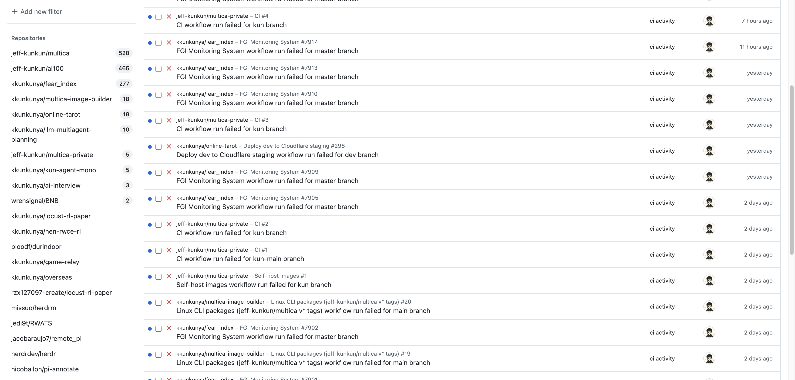

# Office browser operations: agents work on the virtual display

Office agents use Kun's everyday Chrome (his logins and tabs), but their windows live on a
virtual display ("Office Agents", 1920x1080) that sits off the bottom-right corner of his main screen.
Kun's screen, mouse, keyboard and frontmost window stay his. He looks at the agents' work only when he wants to.

Pieces on Kun's Mac (`~/.agents/vd/`, not in this repo):
- `vd-hold`: creates the virtual display and writes its frame to `state.json`. LaunchAgent `com.kun.office-vd-hold`.
- `broker.mjs`: holds the one CDP connection to Chrome and serves it on `http://127.0.0.1:9339`
  (`POST {method, params, sessionId}`, `GET /health`). LaunchAgent `com.kun.office-vd-broker`.
- `vd.mjs`: the agent command line, talking to the broker.

Why a broker: Chrome's remote debugging (`chrome://inspect/#remote-debugging`, 127.0.0.1 only) asks
"Allow remote debugging?" for every new connection. The broker connects once; Kun clicks Allow once per Chrome
launch; agents never open their own connection.
The broker listens on 127.0.0.1 only and has no authentication: any process on this Mac can drive Kun's Chrome
through it. Never expose port 9339 beyond loopback (no `0.0.0.0` bind, port forward, tunnel or proxy). Unanswered prompts stack and block, so never connect to
Chrome's DevTools port directly. The `Chrome-Tarot` profile on port 9235 is separate and stays as is.

Rules for every agent that operates Kun's browser:
- `node ~/.agents/vd/vd.mjs open <url>` opens your page in a new window on the virtual display and prints its
  target id. Drive it through the broker with that target (`Target.attachToTarget`, `Runtime.evaluate`,
  `Input.dispatch*` to the page, `Page.captureScreenshot`); `vd.mjs shot <id> <png>` takes a screenshot.
- `vd.mjs close <id>` when done. Leave Kun's tabs and windows alone.
- Never use AppleScript `activate`, `open -a`, real-mouse clicks or hotkeys on Chrome, and never
  `Page.bringToFront` / `Target.activateTarget` on your own.
- Native apps for Computer Use: move the app's window onto the virtual display first (cua `set_window_frame`
  to the frame in `state.json`), then work with background input only.

Only exception: a page that needs Kun himself (login, scan code, captcha, payment, a real confirmation).
Run `vd.mjs look <id> "<what to click>"`: the window comes to the middle of his main screen and a Mac
notification says what to click. Stop until he has acted, then `vd.mjs back <id>` returns it to the virtual
display and hands Kun's own Chrome window back its main-window status.

Kun looking at the agents: `vd.mjs peek` opens screenshots of every agent page in Preview. To work on the
display directly, drag "Office Agents" next to the main screen in System Settings > Displays > Arrange and move
the mouse over. `launchctl bootout gui/$(id -u)/com.kun.office-vd-hold` removes the display (its windows fall
back to the main screen).

